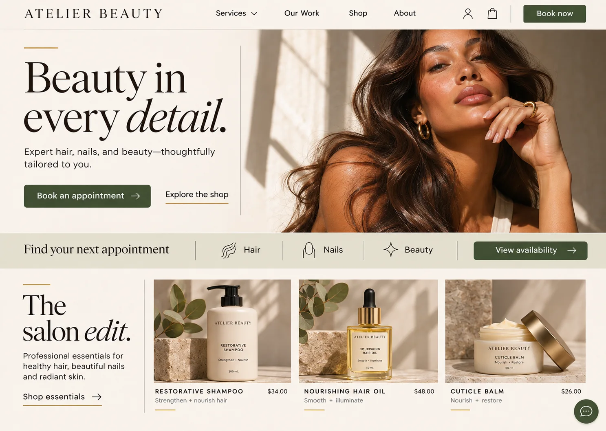
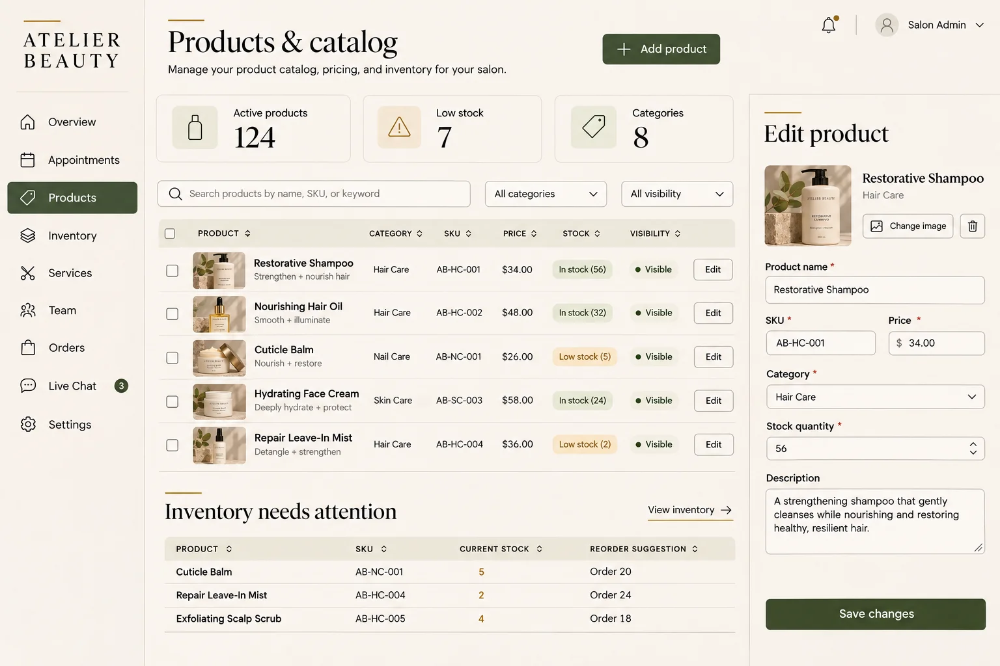
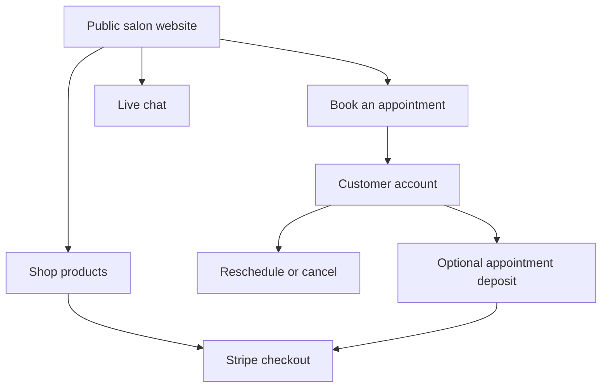
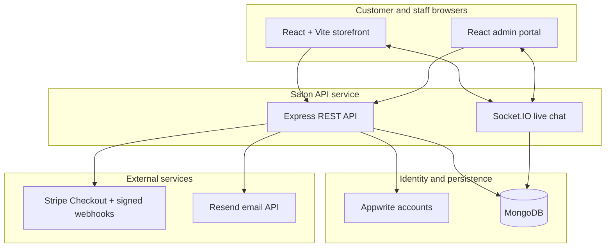
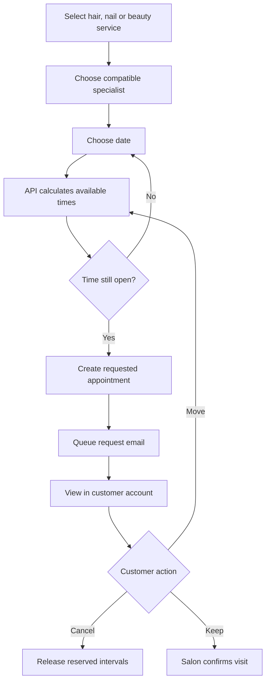
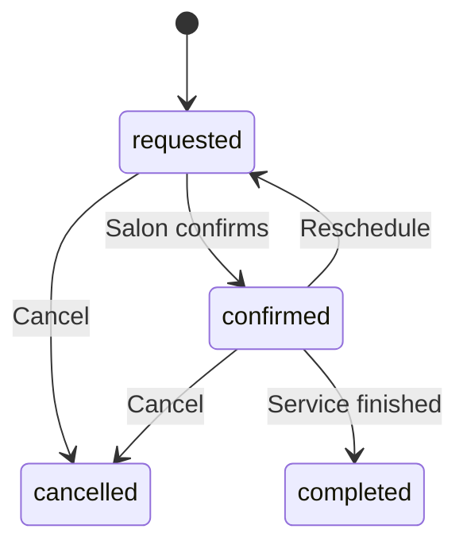
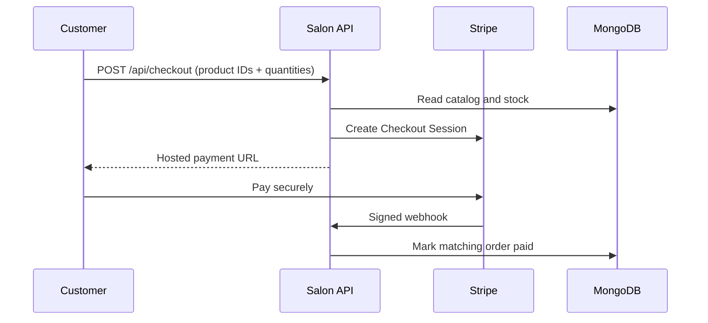
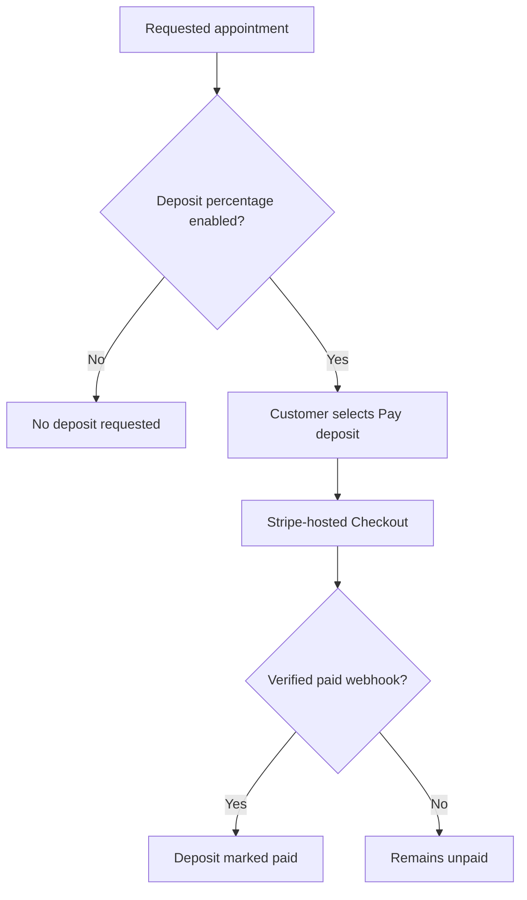
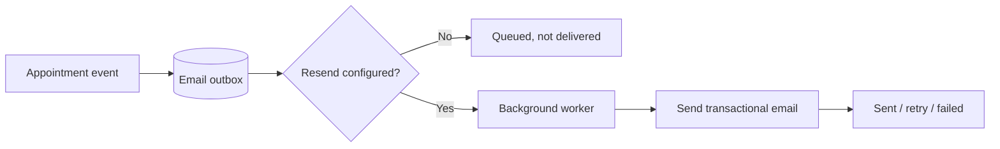
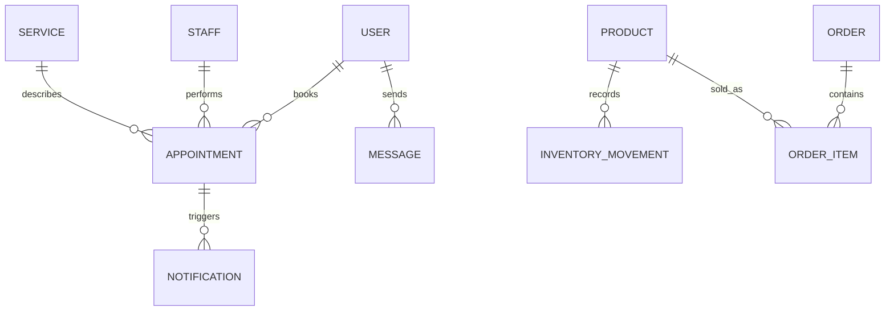

# Atelier Beauty — Salon Platform Template

**A custom beauty, hair, and nail salon platform with a public storefront, customer accounts, appointment scheduling, an admin operations portal, real-time chat, and Stripe payments.**

> [!IMPORTANT]
> **Phase 4 development preview — not production-ready.** “Atelier Beauty,” its photos, product names, services, stylists, pricing, and editorial copy are demonstration content. The real salon must supply its brand, policies, personnel, and payment configuration before launch. This project is **independent of Shopify**.

| Experience | Implemented | Needs configuration / additional work |
| --- | --- | --- |
| Salon website | Responsive home, services, story, shop, booking | Real brand and imagery |
| Client account | Appwrite sign-in integration, appointment history, reschedule/cancel, deposit action | Real Appwrite project; order history |
| Storefront | Products, search/filter, cart, Stripe Checkout Sessions | Shipping, tax, reservations, returns/refunds |
| Scheduling | Live availability, 15-minute blocks, working days, breaks, holidays, special hours | Cancellation cutoff policies, multi-location, calendar sync |
| Admin | Dashboard, products, stock, services, team, weekly appointment calendar, scheduling, orders, chat | Expanded permissions and audit trail |
| Live chat | Socket.IO, private conversations, admin replies | Moderation, agent assignment |
| Notifications | Persistent outbox, updates and 24-hour reminders | Verified email sender and Resend API key |
| Stripe service deposits | Configurable percentage, hosted checkout, signed webhook | Default **OFF**; salon policy and real test-mode verification |

## 1. Visual direction

The selected direction combines the original concepts **1 and 3** with **new concept 1**: editorial salon photography, spacious ivory surfaces, olive-green actions, delicate gold accents, and a commerce presentation that feels like a premium beauty brand.

### Storefront design concept



*Approved concept artwork, **not** an actual running-site screenshot. The real storefront is assembled from responsive React components and separate image assets.*

### Admin design concept



*Admin concept artwork, **not** an actual running-site screenshot. The implemented admin includes functional data views and new scheduling screens beyond this original reference.*

### User experience map



## 2. System architecture



**Why this structure?** The UI never calculates authoritative prices or reserves appointments on its own. The API checks permissions, availability, and payment amounts; MongoDB stores durable operational records. Stripe collects card payments on hosted Checkout pages, keeping card data out of the salon app.

| Layer | Technology | Responsibility |
| --- | --- | --- |
| Frontend | React, Vite, CSS, Lucide icons | Storefront, booking, client area, admin |
| Backend | Node.js, Express, Zod | Validation, auth checks, business rules |
| Realtime | Socket.IO / WebSockets | Authenticated private customer-support chat |
| Primary data | MongoDB | Catalog, inventory, bookings, orders, messages, notification outbox |
| Authentication | Appwrite | Customer sessions, verified server-side JWT identity, admin ID allowlist |
| Retail payments | Stripe Checkout | Product orders, redirects, signed payment notifications |
| Appointment deposits | Stripe Checkout | Optional per-appointment deposit payment, tracked separately from retail orders |
| Email | Resend API | Transactional emails and scheduled reminders when configured |

## 3. Repository layout

```text
salon_platform_template/
├── apps/
│   ├── api/
│   │   ├── src/
│   │   │   ├── app.js             # REST endpoints, security, Stripe/webhooks
│   │   │   ├── server.js          # HTTP + Socket.IO + notification worker
│   │   │   ├── store.js           # Memory and MongoDB persistence
│   │   │   ├── booking.js         # Working hours, holidays, breaks, slots
│   │   │   ├── deposits.js        # Deposit configuration and calculation
│   │   │   ├── notifications.js   # Email outbox and delivery worker
│   │   │   └── seed.js            # Development-only salon data
│   │   └── tests/                # API, booking, payment and email tests
│   └── web/
│       ├── src/
│       │   ├── App.jsx            # App composition and navigation
│       │   ├── BookingPage.jsx    # Live booking selection
│       │   ├── ClientAccount.jsx  # Customer profile and appointments
│       │   ├── admin/
│       │   │   ├── AdminPortal.jsx
│       │   │   ├── BookingCalendar.jsx
│       │   │   ├── SchedulingManager.jsx
│       │   │   └── screens.jsx    # Product, inventory, team, orders, chat
│       │   └── styles.css
│       ├── public/images/         # Example artwork and product photos
│       └── worker/                # Static-hosting worker
├── docs/
│   ├── approved-concept.webp      # Approved storefront concept
│   └── admin-concept.webp         # Admin concept
├── .env.example                   # Configuration template (no secrets)
└── README.md
```

## 4. Customer booking experience

### Booking journey



The booking engine:

1. Uses the salon’s IANA timezone, defaulting to `America/New_York`.
2. Offers start times on **15-minute boundaries**.
3. Checks each service’s actual duration (for example, a manicure may last 45 minutes).
4. Reads the specialist’s weekly working days and hours.
5. Removes slots conflicting with a recurring break, closed date, holiday, or time-off exception.
6. Supports special opening hours for a specific date—even a normally closed weekday.
7. Rejects overlaps with existing `requested` or `confirmed` appointments.
8. Enforces a default **60-minute advance notice** and **90-day booking horizon**.
9. Rechecks conflicts when the customer confirms, so stale browser availability cannot override the database.
10. Returns rescheduled confirmed appointments to `requested` for salon reconfirmation.

### Scheduling example

Suppose Sofia works Tuesday–Saturday, 10:00 AM–6:00 PM, with a daily 12:00–12:30 PM break.

| Requested 45-minute manicure | Result | Reason |
| --- | --- | --- |
| 10:00–10:45 AM | Available if unbooked | Fits working hours |
| 11:15 AM–12:00 PM | Available if unbooked | Ends before break |
| 11:30 AM–12:15 PM | Blocked | Overlaps break |
| 12:30–1:15 PM | Available if unbooked | Starts after break |
| Any time on a closed holiday | Blocked | Day-specific exception |
| 5:30–6:15 PM | Blocked | Extends beyond closing |

The **Admin → Scheduling** section manages those daily breaks and exceptions. Changing a schedule in a way that invalidates an existing upcoming reservation returns an error, asking staff to move or cancel that reservation first.

### Appointment statuses



## 5. Storefront and retail checkout

Customers can browse products, filter categories, add items to the cart, and continue to hosted Stripe Checkout.



The server—not the browser—supplies the product price to Stripe. Payments are not marked successful from a redirect or client-side callback. Orders are updated after a verified webhook reports payment.

**Still to implement before real retail launch:** inventory reservation/decrement after payment, pickup/shipping selection, tax handling, shipping labels, automatic refunds, returns, and a complete customer order-history page.

## 6. Optional appointment deposits

Deposits are distinct from retail product purchases and are **disabled by default**.

To enable them in a test environment, configure Stripe and explicitly set a percentage:

```dotenv
BOOKING_DEPOSIT_PERCENT=25
STRIPE_SECRET_KEY=sk_test_...              # Example format only
STRIPE_WEBHOOK_SECRET=whsec_...            # From Stripe webhook setup
PUBLIC_WEB_URL=http://localhost:5173
```

At 25%, a $45 service produces an **$11.25 deposit**. The API calculates this from the service price and saves the amount when the appointment is created. The customer sees the deposit in **My appointments** and can choose **Pay deposit** to open Stripe Checkout.



Safety properties:

- The percentage is an environment setting, not a customer-provided amount.
- Checkout requires both a secret Stripe key and a valid webhook configuration.
- A short-lived server-side checkout lock reduces duplicate concurrent Checkout Sessions; an unexpired session can be reused.
- Signed Stripe webhook events must match the recorded appointment amount in USD.
- Repeated webhook events do not create duplicate “paid” records.
- A successful redirect **does not** independently mark a deposit paid.

> [!CAUTION]
> This is **optional deposit collection**, not an enforced prepayment policy. Unpaid requests do not currently expire automatically. Cancelling an appointment does **not** automatically refund a paid deposit. Before enabling live payments, the salon must approve its deposit amount, payment deadline, cancellation/refund terms, dispute process, and accounting treatment. Test the entire flow with Stripe test mode first.

## 7. Email notifications

The API maintains a notification outbox for:

- New booking received.
- Booking confirmed by salon staff.
- Appointment rescheduled.
- Appointment cancelled.
- Reminder 24 hours before the appointment, when scheduled far enough ahead.



Delivery is disabled unless **both** `RESEND_API_KEY` and a verified `SALON_EMAIL_FROM` sender are configured. The worker polls roughly every 30 seconds, retries transient errors with a capped backoff, and avoids stale reminders when appointments are changed or cancelled. **Admin → Settings** shows queue counts and whether delivery is configured.

## 8. Live chat and account privacy

- REST messages and Socket.IO rooms are tied to the authenticated user’s conversation ID.
- Salon admins can list conversations and reply.
- Customers cannot request other customers’ conversations.
- Admin access is determined server-side from trusted Appwrite user IDs (`ADMIN_USER_IDS`), not an untrusted browser role.
- Preview role headers work **only** when local demo mode is enabled.
- Never expose `DEMO_MODE=true` on a public deployment.

## 9. Run locally

Prerequisites: **Node.js 22+**, npm, and optionally MongoDB for persistent development data.

```bash
git clone https://github.com/migtam628/salon_platform_template.git
cd salon_platform_template
npm install
```

1. Copy `.env.example` to `apps/api/.env` and configure the API values. For local preview, set `DEMO_MODE=true`.
2. Copy the `VITE_*` values to `apps/web/.env.local`. Set `VITE_DEMO_MODE=true` for a local UI preview.
3. Start frontend and backend with `npm run dev`.
4. Open the Vite URL printed in your terminal (usually `http://localhost:5173`). The API normally uses port `4000`.
5. Browse `/` for the storefront, `/book` for appointments, `/shop` for products, `/account` for the client area, or `/admin` for the salon console.

The frontend dev server proxies `/api` and WebSocket requests to the API. Without `MONGODB_URI`, the demo uses an in-memory database: restarting the backend removes changes. With Appwrite configured and demo disabled, sign-in and permissions use real account sessions.

### Run tests

```bash
npm test
npm run build
```

The test suite checks API authorization, booking conflicts, staff scheduling, rescheduling/cancellation, Stripe configuration safeguards, deposit calculations and checkout state, notification behavior, frontend compilation, and the static-hosting worker. Tests do **not** replace a live Stripe test-mode transaction or manual browser QA.

## 10. Environment configuration

All supported entries are in [`.env.example`](.env.example). Never commit `.env`, live credentials, or Stripe secrets to source control.

| Variable | Purpose | Default / requirement |
| --- | --- | --- |
| `PORT` | Express server | `4000` |
| `WEB_ORIGIN` | Allowed CORS origins | Local Vite URL |
| `PUBLIC_WEB_URL` | Stripe redirect origin | Local Vite URL |
| `DEMO_MODE` | Development-only preview identities/data | `true` locally; **false in production** |
| `MONGODB_URI`, `MONGODB_DB` | Persistent documents, indexes, outbox | Required for production |
| `APPWRITE_ENDPOINT`, `APPWRITE_PROJECT_ID` | JWT-backed customer authentication | Required for production |
| `ADMIN_USER_IDS` | Trusted comma-separated admin account IDs | Configure before production |
| `SALON_TIME_ZONE` | IANA time zone for booking | `America/New_York` |
| `BOOKING_MIN_LEAD_MINUTES` | Advance notice | `60` |
| `STRIPE_SECRET_KEY` | Server-side Stripe client | Required for real payments |
| `STRIPE_WEBHOOK_SECRET` | Signed webhook validation | Required for real payments |
| `BOOKING_DEPOSIT_PERCENT` | Optional service deposit percentage (0–100) | **0 = disabled** |
| `RESEND_API_KEY`, `SALON_EMAIL_FROM` | Transactional email delivery | Optional; both needed |
| `VITE_API_URL` | Browser API origin | Usually empty during local dev |
| `VITE_DEMO_MODE` | Browser demo experience | `true` only for preview |
| `VITE_APPWRITE_ENDPOINT`, `VITE_APPWRITE_PROJECT_ID` | Browser account SDK | Set when using real accounts |

> [!WARNING]
> Never put a Stripe secret, Resend API key, Mongo connection string, or admin identity list in a `VITE_*` variable. Vite exposes these variables to the public browser bundle.

## 11. API endpoints

All routes begin with `/api`. Customer appointment and private chat routes require account authentication; admin routes additionally require an authorized salon admin.

### Catalog, bookings, and accounts

| Method | Endpoint | Description |
| --- | --- | --- |
| GET | `/health` | API availability and safe configuration flags |
| GET | `/products`, `/services`, `/staff` | Public active catalog and team |
| GET | `/availability?serviceId=&staffId=&date=` | Live opening times for a specialist/service/date |
| GET | `/appointments` | Customer’s bookings; all bookings for admins |
| POST | `/appointments` | Validate and reserve requested appointment |
| GET | `/appointments/:id/availability?date=` | Valid times when moving an existing booking |
| PATCH | `/appointments/:id` | Reschedule; returns to `requested` |
| POST | `/appointments/:id/cancel` | Cancel eligible future booking |
| POST | `/appointments/:id/deposit-checkout` | Optional Stripe deposit Checkout URL |
| GET | `/chat/:conversationId` | Private conversation history |
| POST | `/chat` | Store and broadcast chat message |

### Salon administration

| Method | Endpoint | Description |
| --- | --- | --- |
| GET | `/admin/overview` | Operational overview counts |
| GET/POST | `/admin/products` | Product catalog view/create |
| PATCH | `/admin/products/:id` | Edit catalog item |
| GET/POST | `/admin/services` | Service menu view/create |
| PATCH | `/admin/services/:id` | Edit service duration, price, visibility |
| GET/POST | `/admin/staff` | Team view/create |
| PATCH | `/admin/staff/:id` | Edit weekly hours, breaks, and date exceptions |
| GET | `/admin/inventory` | Inventory and adjustment audit |
| POST | `/admin/inventory/:id/adjust` | Audited stock adjustment |
| GET | `/admin/orders` | Retail orders |
| PATCH | `/admin/orders/:id/fulfillment` | Fulfillment on paid orders |
| PATCH | `/admin/appointments/:id` | Confirm/complete/cancel appointment |
| GET | `/admin/conversations` | Admin chat inbox |
| GET | `/admin/notifications` | Email queue status |
| GET | `/admin/integrations` | Safe provider-configuration flags |

### Checkout and event handling

| Method | Endpoint | Description |
| --- | --- | --- |
| POST | `/checkout` | Validate retail cart and create Stripe Checkout Session |
| POST | `/stripe/webhook` | Verify Stripe event signature, persist paid order/deposit status |

## 12. Core data model



An appointment stores the selected service and staff snapshots, precise `startAt`, salon-local `bookingDate`, duration, reserved 15-minute intervals, booking status, customer identity, and—when enabled—the deposit amount and payment state. A MongoDB partial unique multikey index on `staffId + occupiedSlots` prevents overlapping active bookings during concurrent requests. Historical appointments without interval records are migrated during startup where possible.

## 13. Production launch checklist

Use this checklist before giving the site to real paying customers:

- [ ] Replace the demo salon name, images, descriptions, addresses, hours, policies, and prices.
- [ ] Configure HTTPS, DNS, production API hosting, CORS, and secure secrets.
- [ ] Set `DEMO_MODE=false`; configure MongoDB and Appwrite accounts.
- [ ] Enter trusted admin account IDs, establish least-privilege access, and enable MFA where possible.
- [ ] Populate actual staff weekly schedules, breaks, holidays, and special hours.
- [ ] Confirm real service durations, bookings/cancellations, no-show, and deposit policies.
- [ ] If using deposits, test Stripe Checkout Session creation, signed webhooks, duplicate-payment prevention, cancellation, and manual refund procedure in test mode.
- [ ] If using email, verify the sender domain and send genuine test booking/reminder emails.
- [ ] Finish inventory reservation and settlement, pickup/shipping, taxes, refunds, and customer order history.
- [ ] Add rate limiting, stronger audit logs, monitoring, backups, retry visibility, and deployment health checks.
- [ ] Run API tests, production build, hosting tests, mobile/desktop browser QA, accessibility checks, and transactional end-to-end tests.
- [ ] Review webhook delivery/replay behavior and test server restarts during checkout and notification delivery.
- [ ] Get final sign-off from the salon owner before taking live payments.

## 14. Roadmap

| Phase | Description | Status |
| --- | --- | --- |
| 1 | Public website, store, booking shell, API, Appwrite/Stripe/WebSocket foundations | Implemented preview |
| 2 | Product and stock admin, services/team, orders, dashboard and chat inbox | Implemented preview |
| 3 | Live schedule, customer rescheduling/cancellation, weekly admin calendar, email outbox | Implemented preview |
| 4 | Staff breaks/holidays/special dates and configurable appointment deposit collection | Implemented preview |
| 5 | Retail fulfillment, inventory consistency, customer order history, refund operations | Planned |
| 6 | Security hardening, real-provider end-to-end tests, monitoring, deployment | Planned |

### Important limitations

The project is a **template and functional development foundation**, not a finished point-of-sale or production merchant system. It currently does **not** include Shopify, automatic Stripe refunds, recurring subscriptions, SMS reminders, external calendar sync, retail stock deductions after settlement, multi-location scheduling, or a real salon’s configured brand/content. Browser screenshots have not been presented as verified application renders; the images above are clearly labeled design references.

---

**Repository:** [migtam628/salon_platform_template](https://github.com/migtam628/salon_platform_template) · **Maintained for:** a configurable custom beauty/hair/nail salon experience
