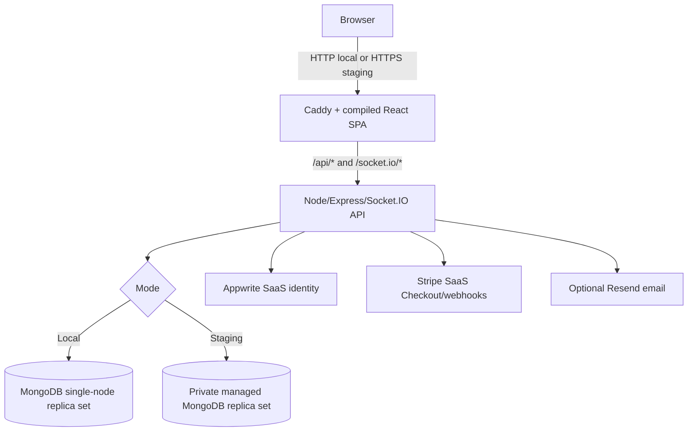
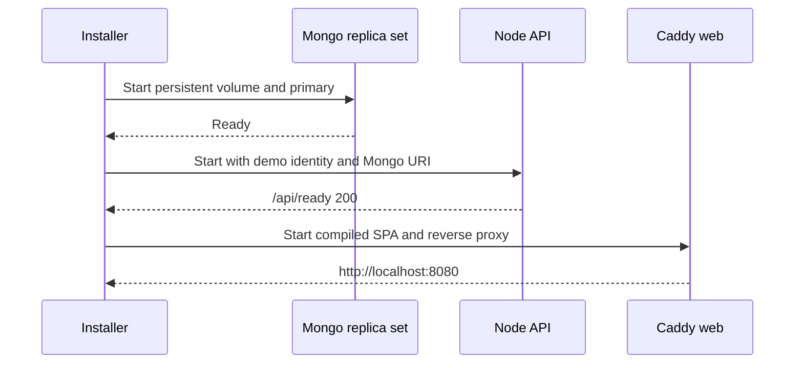
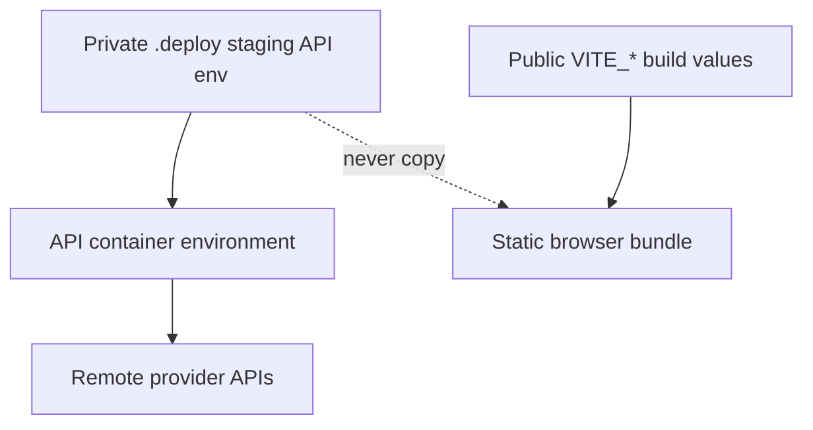

# Salon platform: illustrated Docker installation guide

> **Scope:** Repeatable local preview and protected staging foundation. This installer is **not** a one-click authorization to charge customers. The private test environment must pass payment, email, identity, privacy, backups and business policy checks first.

## 1. What the installer provides



**Containers:** React is compiled in a Node build stage and served by Caddy; the API uses its non-root Node image; local MongoDB runs in an isolated, persistent Docker volume with an idempotent replica-set initialization task. No database or API ports are published on the host. The browser only connects through Caddy. Both API and web images are built from the checked-in lockfile.

**External services:** Stripe payment processing, Appwrite authentication and Resend email are remote providers. This project does not imitate, embed or self-host those accounts. They require separate accounts and securely provisioned settings. The local preview needs none of them.

## 2. Requirements and safety

- Ubuntu/Debian recommended for `--install-docker`; other systems can use an already installed Docker Engine/Desktop and Compose plugin.
- On Ubuntu/Debian, **`--install-docker` explicitly opts in** to system package installation from the official Docker repository; it never uninstalls competing packages or modifies the Docker user group.
- Allow sufficient space for Node, Caddy and MongoDB images; configure filesystem backups before storing customer data.
- Do **not** run the local mode on a public host. It uses demo authentication and MongoDB without network-layer authentication, accessible only from the private Compose network.
- Never commit `.deploy/` files, mount customer secrets into the frontend, or run `docker compose config` into public logs: Compose can expand env values in its output.

## 3. Local full-stack quick start

Clone the repository and enter its root:

```bash
git clone https://github.com/migtam628/salon_platform_template.git
cd salon_platform_template
bash scripts/install.sh local --install-docker
```

If Docker is already available, omit `--install-docker`:

```bash
bash scripts/install.sh local
```

The installer automatically:

1. Creates `.deploy/local-stack.env` and `.deploy/local-api.env` from safe templates, without overwriting existing files.
2. Checks that demo mode is enabled and HTTP binds only to localhost.
3. Verifies the Docker daemon and Compose.
4. Builds the API and storefront containers.
5. Starts a local MongoDB 7 replica set, initializes the primary only if necessary, and preserves its database volume.
6. Starts the API after the replica set is ready, and Caddy after the API is healthy.
7. Checks the proxy `/api/ready` endpoint and prints the local URL.

Open **http://localhost:8080** on the host computer. Visit `/book`, `/shop`, `/account` and `/admin` to inspect example workflows.



### Everyday administration

```bash
bash scripts/stack.sh local status
bash scripts/stack.sh local logs
bash scripts/stack.sh local restart
bash scripts/stack.sh local stop
```

`stop` removes containers/networks but **does not delete named volumes**. Do not run `docker compose down --volumes` unless you deliberately want to delete disposable local data and have checked the exact target project and backup.

## 4. Protected staging over HTTPS

Use a staging-only DNS hostname pointed at the server. Open inbound TCP 80/443 only to Caddy; block direct access to the API and database. Store the staging database outside this Compose project, preferably in a managed, transactional MongoDB replica set.

On first run:

```bash
bash scripts/install.sh staging
```

The installer creates two private files and **stops** until they are configured:

| Private file | What to set |
| --- | --- |
| `.deploy/staging-stack.env` | Real `SALON_SITE_ADDRESS`, public HTTP/HTTPS bindings, `VITE_DEMO_MODE=false`, public Appwrite endpoint/project |
| `.deploy/staging-api.env` | `NODE_ENV=production`, `DEMO_MODE=false`, HTTPS URLs, external MongoDB URI, Appwrite identity, trusted admin IDs; optionally Stripe test keys and verified mail |

The public origin **must match** the configured domain, for example, site `staging.salon.example` with `WEB_ORIGIN=https://staging.salon.example`. The Appwrite endpoint and project must agree between browser and server settings. Never put server-side credentials in `VITE_*`.

After configuring the files in a private editor, run:

```bash
bash scripts/install.sh staging --install-docker
```

Staging checks for demo mode, origins, provider consistency and a dedicated external MongoDB URI. It builds the same containers, runs the existing **offline production preflight inside the API image**, and only then attempts to start services. The API has no published port; Caddy manages HTTP→HTTPS and certificate issuance when DNS and ports are correct.

The installer **cannot** provision external Appwrite, Stripe, MongoDB clusters, DNS, mail domains or certificates in those providers. Even after containers start, run all [production deployment acceptance checks](production-deployment.md) before any launch decision.

## 5. Secrets and configuration



- `.deploy/` is Git-ignored and its files are created with mode `0600`.
- API keys and MongoDB credentials belong only in `.deploy/staging-api.env` or a managed deployment secret store.
- Vite settings are compiled into browser JavaScript; only public Appwrite endpoint/project values belong there.
- The local example never requires a Stripe key; checkout remains disabled until the private staging provider is configured.
- Use separate credentials and data for staging, and rotate any secret accidentally exposed in logs or Git history.

## 6. Updating safely

1. Back up the external staging database and any required configuration, and confirm a restore path.
2. Review the incoming commit and update any public `VITE_*` values before rebuilding.
3. Run `bash scripts/install.sh staging` again; it does **not** overwrite `.deploy/` credentials or delete volumes.
4. Confirm `bash scripts/stack.sh staging status` and check `https://your-domain/api/ready`.
5. Exercise sign-in, appointment conflict prevention, checkout, webhooks, refunds, chat and notification delivery.
6. If a release fails, preserve logs and database state. Restore compatible API/web image versions; never overwrite later customer records without a controlled recovery plan.

## 7. Troubleshooting

| Symptom | Likely cause | Check |
| --- | --- | --- |
| Docker permission error | Daemon down or restricted socket | Docker service and authorized user; installer can use `sudo docker` when permitted |
| Installer stops before staging | Example domain, demo mode, credentials or origins invalid | Both private `.deploy/staging-*.env` files |
| API remains unhealthy | Mongo URI, replica-set election, provider setup or invalid production config | `scripts/stack.sh local logs` or `staging logs` |
| Caddy serves no HTTPS certificate | DNS not pointing to server; port 80/443 blocked | DNS/ACME connectivity and Caddy logs |
| Login fails in staging | Appwrite project/domain mismatch | Appwrite registered web platform and the matching `VITE_*` build values |
| Checkout returns `503` | Stripe disabled or missing signing secret | Both server-side Stripe test keys, test webhooks and acceptance checklist |
| Email queued but not received | Sender not verified or Resend not configured | Verified domain, API key, sender address and outbox counts |

### What is verified?

- Existing CI has verified the standalone API Docker build and boot and the MongoDB transaction test harness.
- The new Compose installation has a dedicated CI build/start/HTTP-smoke job. Inspect its current result before asserting the complete stack is verified.
- Production database recovery, external authentication, Stripe, email and customer-domain HTTPS remain **unverified** until a private staging test is completed.
