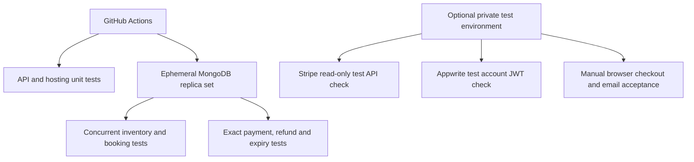
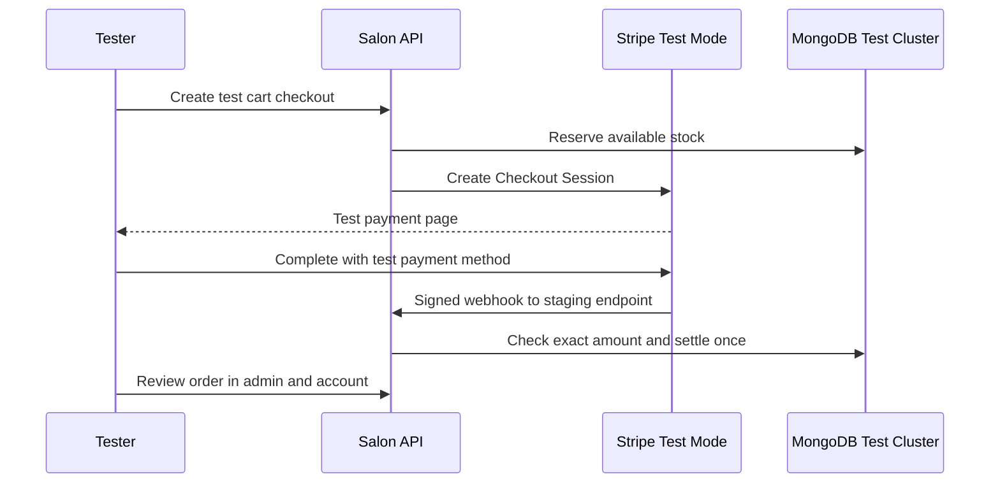

# Phase 7 — External provider acceptance testing

> **Status:** Repeatable test harnesses are implemented, but this document does **not** certify Stripe payments, Appwrite identities, or customer email delivery in a live tenant. Only the MongoDB replica-set checks are configured to run automatically in GitHub Actions; provider smoke tests need explicitly provided test credentials. Never put production secrets in CI or source control.

## What the verification covers



The Mongo integration suite connects only to a **local** replica-set test server, creates a uniquely named database, verifies behavior, then drops **only that newly created database**. It refuses to run against remote MongoDB hosts or when `NODE_ENV=production`.

## 1. Automated checks available immediately

```bash
npm ci
npm test
npm run test:integration
```

The regular suite runs automatically. With no opt-in connection details, the integration tests report **SKIP**—which does not mean a provider was verified. The GitHub Actions `mongo-integration` job starts its own isolated MongoDB replica set and sets `MONGODB_TEST_URI` to run the transaction tests. Inspect the job result after each push; a local green unit suite alone is not enough.

### MongoDB acceptance cases

| Scenario | Expected result |
| --- | --- |
| Two buyers reserve the last physical unit simultaneously | Exactly one succeeds; one receives a stock conflict |
| Wrong Checkout amount | Payment rejected; reserved order remains pending |
| Replayed valid payment | Stock consumed once; one sale movement |
| Replayed full refund with verified physical return | Stock restored once; one restock movement |
| Two bookings overlap on the same specialist's 15-minute blocks | One appointment created, one rejected by MongoDB uniqueness |
| A pending Checkout reservation expires | Held stock released; no physical stock consumed |

**Manual local Mongo setup:** Start a disposable single-node MongoDB replica set and initialize it as primary. Supply `MONGODB_TEST_URI=mongodb://127.0.0.1:27017/?replicaSet=rs0` only for your isolated local test server. Run `npm run test:integration`. Do not point this at an existing customer database.

## 2. Opt-in Stripe TEST-mode connection check

This smoke test **reads** the Stripe account's test-mode balance. It does not create a payment, a session, or a refund.

1. Obtain an `sk_test_` secret in a protected test environment.
2. Set `STRIPE_TEST_SECRET_KEY` in the local process environment or a secret manager. Do not commit or paste it into CI logs.
3. Run `npm run test:integration`.
4. Confirm that the real Stripe connection test passes rather than reporting SKIP.

The test explicitly refuses `sk_live_` credentials. Failure messages omit credentials and provider payloads.

## 3. Opt-in Appwrite identity check

Use a disposable *customer* identity in a test project:

1. Set `APPWRITE_ENDPOINT` to a valid HTTPS Appwrite endpoint.
2. Set `APPWRITE_PROJECT_ID` to the test project.
3. Set `APPWRITE_TEST_USER_ID` to the expected test customer's account ID.
4. Set `APPWRITE_TEST_JWT` to a recently issued JWT for that account, using a protected environment variable.
5. Run `npm run test:integration` and confirm the returned account matches the expected ID, the local API accepts the JWT for customer appointments, unauthenticated appointment reads return `401`, and the same customer cannot read admin integrations (`403`). The test never prints the token or email.

The full API customer/admin permission matrix still requires browser-level tests with two distinct customer accounts and an admin. This smoke test exercises the actual API middleware but does not cover all role transitions or account isolation scenarios.

## 4. Manual Stripe Checkout acceptance

After the automated connection tests pass, configure the application in a **private staging environment** using a MongoDB replica set, Appwrite test project, Stripe test-mode keys and a Stripe test-mode webhook signing secret.



Checklist:

- [ ] Complete one real Stripe **test-mode** retail Checkout from the storefront, with a test payment method from Stripe documentation. Verify correct price and quantity before payment.
- [ ] Verify the Stripe Dashboard test event arrives at `/api/stripe/webhook` with a valid signature, and an authenticated account sees exactly one paid order.
- [ ] Replay the same event and verify inventory remains unchanged; send a deliberately invalid signature in an isolated staging test and expect HTTP `400`.
- [ ] Test a failed/abandoned Checkout, including a server restart during the reservation. Verify eventual stock release.
- [ ] Test a refund initiated by an admin, both **without** and **with** physically confirmed returned stock. Never restock purely on the refund button click.
- [ ] Test a delayed paid event after reservation expiry. The order must enter `paid_stock_review`, not fulfill automatically.
- [ ] If booking deposits are enabled, separately verify deposit settlement from the signed webhook and documented cancellation/refund handling.
- [ ] Use **two** customer Appwrite accounts to confirm appointments, orders and chats stay private. Confirm an untrusted customer cannot gain admin access.
- [ ] Connect the real verified email sender, confirm actual receipts/reminders, and test queued retry after provider outage.
- [ ] Record evidence: test event IDs, order IDs, observed inventory before/after, expected versus actual status, browser screenshots and timestamp. Do not record card numbers or secret keys.

**Do not turn on Stripe live mode** until all applicable checks, salon operational policies, tax requirements, backup-restore drills and owner sign-off are complete.

## 5. Evidence sheet

| Test | Expected | Actual result | Evidence | Owner sign-off |
| --- | --- | --- | --- | --- |
| CI API + hosting | Green on Node 22 and 24 | Pending CI review | Run URL | Pending |
| CI Mongo replica-set transactions | All integration subtests pass | Pending CI review | Run URL | Pending |
| Stripe read-only test API | Authenticated test-mode balance | Not yet configured | Private run log | Pending |
| Appwrite identity and API authorization | JWT resolves to test user; customer `200`, guest `401`, admin `403` | Not yet configured | Private run log | Pending |
| Hosted checkout and signed event | One paid order, one stock settlement | Not yet run | Test event and order IDs | Pending |
| Refund and late event | Correct one-time restock/manual review | Not yet run | Event IDs and inventory | Pending |
| Customer/admin/browser | Private records and appropriate permissions | Not yet run | QA screenshots | Pending |
| Backup and restore | Verified isolated recovery | Not yet run | Restore record | Pending |

Update the Actual result and Evidence columns as testing occurs. The checklist intentionally distinguishes **implemented tests** from **observed passing provider transactions**.
