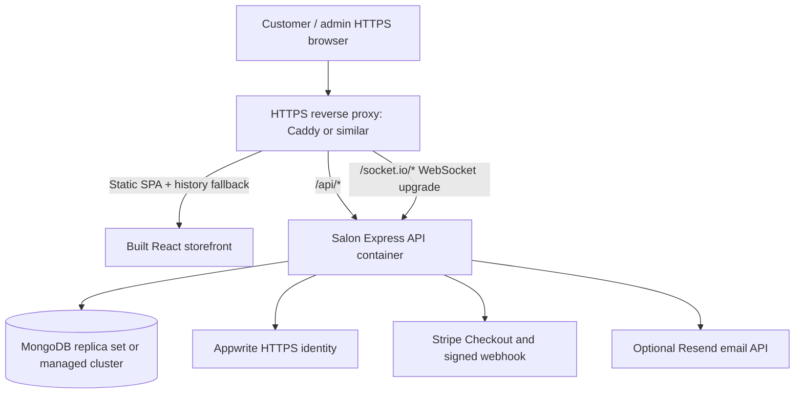

# Production deployment runbook

> **Launch gate:** This is a *deployment foundation*, not permission to take live payments. Stripe, Appwrite, MongoDB transactions, email, backup restore, and the salon's operational policies still require hands-on verification. No real credentials or deployed service are bundled.

## 1. Deployment topology



Keep MongoDB and the API's internal port off the public internet. TLS ends at a trusted proxy. Back up the actual databases and secrets outside the container.

## 2. Prerequisites

1. A domain with HTTPS and a trusted reverse proxy that forwards both standard `/api/` requests and WebSocket upgrades at `/socket.io/`.
2. A production-ready MongoDB **replica set** (or managed transactional cluster), with network restrictions, authentication, backups, and a tested restore procedure. A standalone MongoDB server cannot run this project's multi-document retail checkout transactions.
3. An Appwrite project with allowed web origins, customer login, and at least one trusted admin user ID.
4. A Stripe account in **test mode**, a configured `POST https://your-domain/api/stripe/webhook` endpoint and signing secret. Leave the live keys unset until test-mode checkout, expiration, refund and replay tests pass.
5. Correct salon identity, staff hours, customer consent/privacy policies, prices, pickup instructions, taxes, refunds, accessibility review, and a staffed support inbox.

## 3. Secure API configuration

Store API credentials in a server-side secret manager or restrictive file **outside the source repository**, and populate the entries documented in [`.env.example`](../.env.example).

At minimum configure:

```dotenv
NODE_ENV=production
DEMO_MODE=false
PORT=4000
WEB_ORIGIN=https://salon.example
PUBLIC_WEB_URL=https://salon.example
MONGODB_URI=mongodb+srv://REPLACE_WITH_PRIVATE_SECRET
MONGODB_DB=salon_platform
APPWRITE_ENDPOINT=https://appwrite.example/v1
APPWRITE_PROJECT_ID=REPLACE_WITH_PROJECT_ID
ADMIN_USER_IDS=REPLACE_WITH_TRUSTED_ID
TRUST_PROXY_HOPS=1
ACCESS_LOGS=true
```

The values above are examples, not real endpoints. Never put secrets in `VITE_*` or commit a real `.env`. Production startup refuses missing persistent identity/database config, a demo role, missing admin allowlist, malformed origins, non-HTTPS client URL, and one-sided Stripe secrets. Configure `TRUST_PROXY_HOPS=1` **only** if there is exactly one trusted hop and users cannot reach Express directly. Otherwise leave it `0`; forged forwarding headers must not control IP-based rate limits.

For Stripe test mode, set both `STRIPE_SECRET_KEY` and `STRIPE_WEBHOOK_SECRET`. For production with no retail/deposit payments, leave both unset and understand that checkout returns `503`. Appointment deposits additionally need `BOOKING_DEPOSIT_PERCENT` above `0`. Configuring secrets is not evidence that they work.

## 4. Build and run

From the repository root:

```bash
npm ci
npm test
npm run build
docker build -f apps/api/Dockerfile -t salon-api:local .
```

Run the API with a separately protected environment file, using a local-only bound port behind the reverse proxy:

```bash
docker run -d --name salon-api --restart unless-stopped \
  --env-file /etc/salon/api.env \
  -p 127.0.0.1:4000:4000 salon-api:local
```

The `apps/api/Dockerfile` is a build artifact; the container has no local MongoDB bundled and requires real services. Docker image build has not been verified in this development environment, where the Docker CLI is unavailable.

For the browser, create `apps/web/.env.production` with only `VITE_*` public values. Use `VITE_DEMO_MODE=false`, `VITE_API_URL=` for same-origin reverse-proxy operation, and the real Appwrite browser project settings. Then build the browser and publish `apps/web/dist/client/` as your web root with SPA history fallback to `index.html`. The extra `dist/server` and `.openai` outputs are for the alternative Sites preview hosting target; do not accidentally serve them as public static files.

### Example reverse proxy (Caddy)

```caddyfile
salon.example {
    handle /api/* {
        reverse_proxy 127.0.0.1:4000
    }
    handle /socket.io/* {
        reverse_proxy 127.0.0.1:4000
    }
    handle {
        root * /srv/salon/web
        try_files {path} /index.html
        file_server
    }
}
```

Set the actual DNS/domain, move built `dist/client` content to `/srv/salon/web`, and secure the Caddy host appropriately. Use a different reverse-proxy target if the API and proxy run in separate containers or machines. Confirm WebSocket upgrades work through the public hostname before launch.

## 5. Health checks and monitoring

| Signal | Endpoint / source | Interpretation |
| --- | --- | --- |
| Process liveness | `GET /api/health` | Express is responding; **not** proof MongoDB works |
| Database readiness | `GET /api/ready` | MongoDB ping successful (`503` when unavailable); local demo only tests memory-store health |
| Request trace | `X-Request-ID` header | Correlate a failed HTTP request with logs |
| Structured request log | stdout `http.request` JSON | Method, route pattern, HTTP status, elapsed milliseconds; no request body or credentials |
| Payment failures | stdout `stripe.webhook.failure` | Webhook event ID/type, request ID, failure reason; investigate promptly |
| Business operations | Admin Orders, Inventory, Notifications | Reconcile stock-review paid orders, refund states, outbox retries |

Use HTTPS monitoring from outside the host, notify operators for repeated `503`, `5xx`, webhook processing failures, mail retries, and overdue stock-review orders. Ship logs to your preferred monitoring service; the project does **not** provision an alerting account or durable log store. The in-process rate limiter is defense-in-depth only; at multiple API instances, put distributed limits/WAF at the proxy or edge.

## 6. Test-mode acceptance before launch

- [ ] A real Appwrite customer can sign up, sign in, book, change, and cancel **only their own** appointment.
- [ ] A real admin can manage products, staff, schedules and orders; a normal customer receives `403` on admin endpoints.
- [ ] MongoDB replica-set checkout works under **two concurrent buyers** with only one item available; no oversell.
- [ ] Stripe test-mode Checkout creates an order with exactly the server-supplied price and stock reservation.
- [ ] A valid signed paid webhook settles once; invalid signature/amount/currency, replay, and delayed webhook are safe.
- [ ] Expired/abandoned checkout releases held stock, including after an API restart.
- [ ] A full test-mode refund updates the order once; restock occurs **only** after the physical return and successful refund.
- [ ] Optional deposits: paid only from the webhook; cancellation and refund procedures are documented and exercised.
- [ ] Real transactional emails are delivered and expired/remapped reminders do not send incorrectly.
- [ ] WebSocket chat works over HTTPS behind the reverse proxy, and customer conversation isolation is preserved.
- [ ] Verify all pages on actual mobile and desktop browsers, keyboard navigation, color contrast, and screen-reader labels.
- [ ] Perform a complete backup, restore into a **separate environment**, restart the API during checkout, and practice rollback.
- [ ] Review legal/privacy, tax, returns, payment-dispute, cancellation, and customer support policies with the salon owner.

The automated suite mocks external providers. Green CI alone **never** substitutes for these checks.

For a concrete execution matrix, follow [Phase 7 integration acceptance](integration-acceptance.md). It adds an isolated GitHub Actions MongoDB replica-set test job and private opt-in read-only connection tests for Stripe test mode and Appwrite. Green local tests may include skipped providers; always inspect the actual CI job and staging evidence before approving launch.

## 7. Failure recovery

1. For `503 /api/ready`, inspect database reachability and driver errors, then verify the MongoDB replica set. Do not retry Stripe Checkout blindly if a reservation may still exist.
2. For Stripe webhook failures, inspect the request ID and event ID in logs, compare the Stripe event to the stored order/appointment, then ask Stripe to retry after resolving the cause. **Do not manually flip a payment to paid** from a browser redirect.
3. For paid orders marked `paid_stock_review`, do not fulfill. Reconcile the late payment versus physical stock, and refund when appropriate.
4. For notifications stuck in `pending`/`failed`, verify sender setup and provider availability; do not assume queued means delivered.
5. Before rollback, preserve database backups and verify compatibility of the older API with the current schema. Rollback the container/frontend versions together; do not restore a database over newer customer data without an authorized recovery plan.

